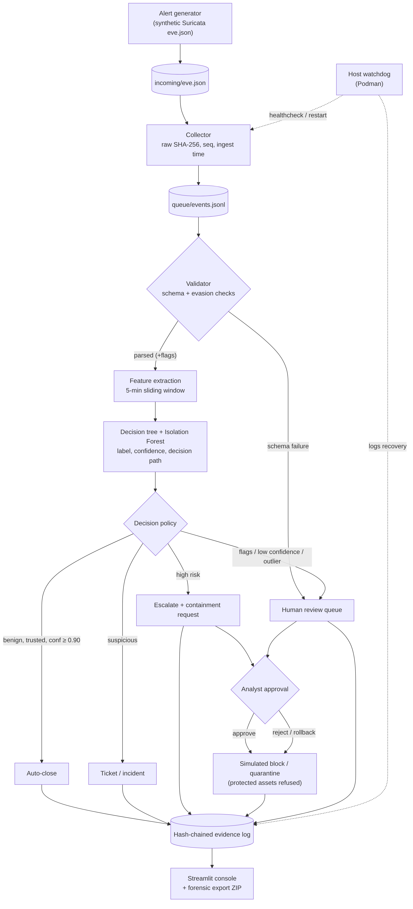

# GCY20 Capstone: AI-Assisted SOC Pipeline (Technical Track)

A small but complete AI-assisted detection and response pipeline. It runs on **Podman** and uses only simulated data. It takes in Suricata-style alerts, checks them for tampering and evasion, classifies them with an explainable decision tree, routes them through a human-in-the-loop decision policy, takes simulated containment actions, and records every step in a hash-chained evidence log.

> **Lab use only.** All "external" IPs come from the RFC 5737 documentation ranges, and the blocklist and quarantine are text files. Nothing touches a real network.



## How each requirement is met

| Capstone requirement | Where it lives |
|---|---|
| Autonomous / semi-autonomous agent | `pipeline/engine.py` + `pipeline/decision.py`: classifies, scores and routes every event |
| Event intake pipeline | `pipeline/collector.py` tails `eve.json` and stamps each line with SHA-256, sequence number and ingest time |
| Threat classification | `pipeline/classifier.py`: decision tree with labels benign / suspicious / credential_attack / lateral_movement / high_severity, plus an Isolation Forest outlier check |
| Logging & evidence preservation | `pipeline/evidence.py`: hash-chained log recording raw-event hash, features, model version, policy hash, label, confidence, decision path, decision, action and analyst |
| Bypass / evasion handling | `pipeline/validator.py`: catches schema violations, malformed JSON, base64 / escaped encodings, homoglyphs, zero-width characters, prompt-injection text, hex-encoded IPs, severity downgrades, future timestamps and replayed lines. **Flagged events are never auto-closed.** |
| Self-healing / response action | `ops/watchdog.py` restarts unhealthy containers. `pipeline/response.py` handles simulated IP block / host quarantine (after approval), protected-asset refusal and rollback |
| Optional: human-in-the-loop | Containment needs analyst approval by name, and every override needs a justification |
| Optional: explainability | Decision path shown per alert (`dashboard` → Alerts / Review queue), plus `models/artifacts/tree_rules.txt` |
| Optional: SOAR workflow | Related alerts merge into one incident per source, with severity upgrades, containment requests, approvals and rollback |
| Optional: forensic export | `pipeline/export_case.py`: ZIP with raw events, evidence records, chain verification, model card, policy and a SHA-256 manifest |
| Optional: LLM enrichment | `pipeline/llm_enrich.py`: Ollama, **off by default**, advisory only, with prompt-injection filtering and prompt/output logging |
| Optional: ATT&CK mapping | `pipeline/attack_map.py`: a static lookup table, so technique IDs can't be invented |

## Run it (Windows + Podman Desktop)

You need Podman 4.3+ with a running machine, a compose provider, and Python 3.10+ on Windows for the watchdog. Run these from PowerShell in the repo folder:

```powershell
# 1. Build and start the three containers (first build takes a few minutes)
podman compose up -d --build
podman ps                      # soc-collector, soc-engine, soc-dashboard: wait for (healthy)

# 2. In a second PowerShell window: start the self-healing watchdog
python ops\watchdog.py

# 3. Open the console
start http://localhost:8501

# 4. Send events
podman exec soc-engine python -m generator.generate --scenario demo     # attack story
podman exec soc-engine python -m generator.generate --scenario bypass   # evasion tests
podman exec soc-engine python -m generator.generate --scenario background --count 30
```

Other useful commands:

```powershell
podman logs -f soc-engine                                         # live decisions
podman exec soc-engine python -m pipeline.evidence verify         # check the hash chain
podman exec soc-engine python -m pipeline.export_case ALL --analyst raji
podman cp soc-engine:/data/exports .\exports                      # copy exports to Windows
podman exec soc-engine cat /data/response/blocklist.txt
podman exec soc-engine cat models/artifacts/model_card.md
```

**Self-healing demo:** `podman exec soc-collector touch /data/state/collector.fault` puts the collector into a simulated hang: it keeps running but stops heartbeating and forwarding. After about 15–25 s the watchdog prints `service_restarted`. The collector records `collector_recovered` and resumes from its saved offset, so events sent during the hang are not lost. As a second test, `podman stop soc-collector` triggers `service_started`.

**Reset everything:** stop the watchdog (Ctrl+C), then `podman compose down -v`. The `-v` deletes the data volume.

**Run the tests (optional, on any machine with Python):**
```powershell
pip install -r requirements-dev.txt
python -m pytest -q
```
The 18 tests cover validator flags, decision safety rules, end-to-end scenarios, approval and protected-asset refusal, tamper and deletion detection, export manifests, and collector resume.

### Troubleshooting

* **`pip install` fails during build with an SSL error:** a corporate proxy or TLS inspection is in the way. Build on a network without TLS inspection, or add your organization's CA certificate to the image.
* **Dashboard not reachable:** check that `podman ps` shows `127.0.0.1:8501->8501`, and that `podman machine list` shows the machine running.
* **Slow or out of memory:** the machine has 2 GiB by default. `podman machine stop; podman machine set --memory 4096; podman machine start`.
* **The watchdog shows "central evidence log unavailable":** the engine container is down. The event is still in `ops\watchdog_log.jsonl`, and the watchdog will start the engine on the next pass.

### Optional: LLM enrichment

1. Install Ollama for Windows and run `ollama pull llama3.1:8b`.
2. In `compose.yaml`, set `LLM_ENABLED: "true"` under `engine`, then run `podman compose up -d`.
3. Escalated alerts get an advisory summary, which appears under Alerts → Inspect alert. Events flagged for injection or obfuscation are never sent to the model.

## Suggested 5-minute demo script

| Time | Show |
|---|---|
| 0:00–0:30 | Architecture diagram; `podman ps` showing three healthy containers and the watchdog window |
| 0:30–1:30 | Run `--scenario demo`. Overview tab fills in: benign alerts auto-closed, brute force merged into **one** incident, lateral movement and C2 escalated |
| 1:30–2:15 | Incidents tab: open the brute-force incident and show the decision path and ATT&CK T1110. Approve the block (name required), show the blocklist in the System tab, then **roll back** |
| 2:15–2:45 | Approve quarantine of the domain controller (10.0.0.10). It is **refused** as a protected asset |
| 2:45–3:45 | Run `--scenario bypass`. Review queue: base64 signature, Cyrillic homoglyph, prompt injection, Mimikatz with downgraded severity (the model alone says *benign 1.0*; the validator catches it), malformed JSON, replay. Resolve one with a justification |
| 3:45–4:30 | Fault injection on the collector. The watchdog restarts it, and the evidence log shows `service_restarted` + `collector_recovered` |
| 4:30–5:00 | Evidence tab: **Verify hash chain**. Build and download a forensic export and open its MANIFEST.json |

## Design notes (for the walkthrough PDF)

**Why a decision tree:** analysts and auditors can read every decision as a short list of feature thresholds. That answers leadership's "can we trust it" concern better than a higher-accuracy black box. The Isolation Forest adds a check for inputs that look unlike anything seen in training.

**Decision policy (`config/policy.json`):** auto-close needs `benign`, confidence ≥ 0.90, and no validation flags or outlier flag. A high-risk label with confidence ≥ 0.60 escalates and *requests* containment. Containment runs only after a named analyst approves, unless `auto_contain` is enabled (it is off). Protected assets are never contained automatically.

**Forensic readiness:** chain of custody starts at the collector, which takes the SHA-256 of the exact raw bytes. Every decision record links that hash to the model version (SHA-256 of the model file), the policy hash, the features, the decision path and the outcome. Records are hash-chained, so editing or deleting a row is detectable. Exports carry a per-file hash manifest and are themselves logged.

**Security choices:** containers are rootless, run as a non-root user, and use `cap_drop: ALL` and `no-new-privileges`. The console listens on localhost only. The watchdog runs on the host instead of mounting the Podman socket into a container.

**Known limitations:**
* The model is trained and tested on synthetic data from the same generator, so its accuracy will not carry over to real traffic.
* It sees only alert metadata, not payloads, endpoint telemetry or user identity.
* Sliding windows are per source IP, so distributed attacks from many sources are under-counted.
* The evidence chain is tamper-evident, not tamper-proof. Someone with write access could rebuild the whole chain. A production system would anchor the head hash externally (WORM storage or a signed timestamp).
* Evasion detection is heuristic. New encodings will get past it until a rule is added.
* The console has no authentication; the analyst name is self-declared.
* Containment is simulated. There is no integration with a firewall, EDR or ticketing system.

## Repository layout

```
compose.yaml          Podman/Compose services (collector, engine, dashboard)
Containerfile         single image; trains the model at build time
config/policy.json    thresholds, protected assets, auto-contain switch
data/reputation.csv   simulated threat-intel reputation scores
generator/            synthetic Suricata alerts: demo, bypass, background, training data
pipeline/             collector, validator, features, classifier, decision, response, evidence, export
models/train.py       trains the tree + Isolation Forest, writes model card / metrics / rules
dashboard/app.py      Streamlit analyst console
ops/watchdog.py       host-side self-healing watchdog for Podman
tests/                pytest suite
docs/                 architecture diagram (Mermaid source + PNG)
```

## Integrity statement

I confirm that this submission is my original work. External tools, references, datasets, frameworks and code libraries used in this project are acknowledged: Python, scikit-learn, Streamlit, Pydantic, pandas, Podman, Suricata's eve.json format, MITRE ATT&CK, and OWASP LLM Top 10. AI assistance (Claude) was used to help scaffold the code; the design decisions, testing and analysis are my own.
